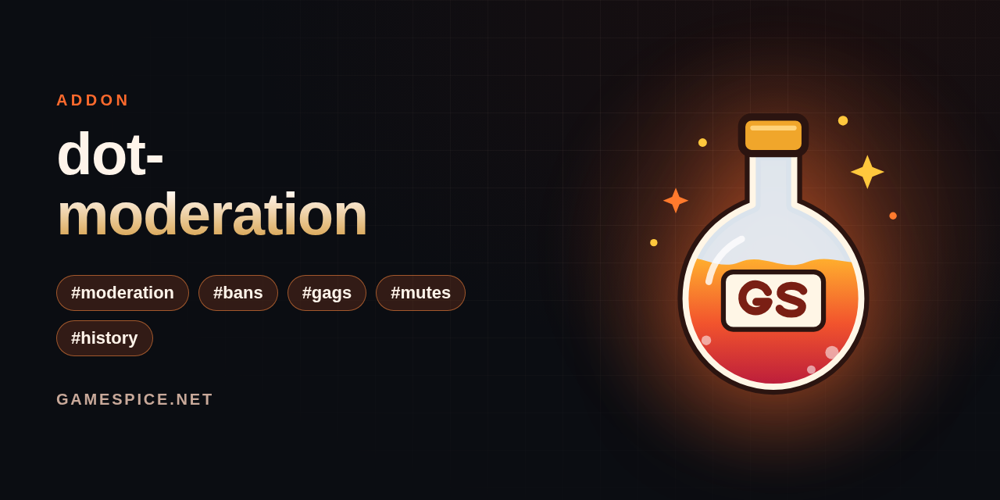

[](https://moddingcommunity.com/a/19-gs-moderation)

Bans, kicks, chat gags, voice mutes and warnings as one durable record that survives a reconnect, with pluggable storage so several servers can share one list. Also the live tools a moderator uses on a player: teleporting, freezing, noclip and so on.

Part of the [**GameSpice**](https://gamespice.net) collection: modular, MIT-licensed building blocks for games on the GameSpice platform (only the TMC website back end is closed). It was built with Claude Code and its headless suite passes, but little of it has met real players yet, so expect rough edges and please report what you find.

## Install

Copy `addons/gs_moderation/` and [GameSpice Core](https://github.com/gamespice-platform/core)'s `addons/gs_core/` into your project and enable gs-moderation in **Project > Project Settings > Plugins**. gs-core is the only dependency. It works with [GameSpice Server](https://github.com/gamespice-platform/server) and [GameSpice Voice](https://github.com/gamespice-platform/voice) without importing either.

## Why it exists next to Server

GameSpice Server already has bans, kicks, admin flags and an audit log. What it lacks is a mute that outlives a session: `GSClientSession.silence()` sets flags on a session object that dies on disconnect, so a muted player reconnects and can talk again. Here a mute is the same kind of record as a ban: stored, expiring, scoped and revocable. Use one ban system, not both.

## Punishments

A `GSPunishment` has a kind (`BAN`, `KICK`, `VOICE_MUTE`, `GAG`, `WARN`), a subject, a reason, an issuer, an issue time and an expiry.

- The subject is a durable key, never a peer id (peer ids are reused). `GSPunishmentSubject` spells them as `uid:backbone:abc` or `ip:203.0.113.9` (port stripped). Set `key_for_peer` to map your identity model. If you do not, `describe_lines()` says so.
- Expiry is checked on read, never swept on a timer, so a server that was off overnight does not enforce yesterday's mutes.
- Revoking keeps the record as history. Kicks and warnings are never "active".
- `ban_uid` bans an account and `ban_address` bans an address (which also catches a household or shared NAT). Use both.

### Enforcing bans

This addon cannot refuse a connection itself. The manager registers under `gs_ban_source` and GameSpice Server calls `check_admission(uid: String, address: String) -> GSResult` on every join. With nothing registered a ban stops nobody, and `describe_lines()` says so. `GSModerationManager.register_ban_source` controls this.

## Storage

Every backend holds the same table, defined in `GSPunishmentSchema`.

| Backend | Class | Notes |
| --- | --- | --- |
| JSON file | `GSPunishmentStoreFile` | Works out of the box. Right for one server. |
| REST API | `GSPunishmentStoreRest` | Works out of the box. Four endpoints, so you can keep your own ban system. |
| SQLite | `GSPunishmentStoreSql` + GameSpice SQL `GSSqlDriverSqlite` | Needs the [godot-sqlite](https://github.com/2shady4u/godot-sqlite) extension. |
| PostgreSQL, MySQL, MariaDB | `GSPunishmentStoreSql` + GameSpice SQL `GSSqlDriverGateway` | Needs an HTTP gateway beside the database. GameSpice SQL ships a reference one. |

Godot cannot speak the Postgres or MySQL protocols itself, and a game server should not hold a database password anyway, so the drivers live in [GameSpice SQL](https://github.com/gamespice-platform/sql). GameSpice SQL is optional. Statements are always parameterised.

REST contract:

```
GET    {base}/punishments                  -> {"punishments": [ {...}, ... ]}
GET    {base}/punishments?subject=uid:123  -> the same, filtered
PUT    {base}/punishments/{id}             <- one record   -> {"ok": true}
DELETE {base}/punishments/{id}                             -> {"ok": true}
```

A record is the JSON from `GSPunishment.to_dictionary()`, the same format every backend uses. A failed read is never an empty list, so an outage cannot silently readmit everyone: the manager keeps what it had.

## Moderator tools

`GSModTools` acts on players in front of the moderator. Positions come from your `position_fn` and moves go through your `teleport_fn` (positions are `Variant`, so 2D works).

| Call | Does |
| --- | --- |
| `teleport(actor, target, to)` | Move a player to a position. |
| `bring(actor, target)` | The player comes to the moderator. |
| `goto(actor, target)` | The moderator goes to the player, stopping short. |
| `send(actor, target, destination)` | One player to another. |
| `return_player(actor, target)` | Put them back. Every move saves a position first. |

Every action is added to the target's history as a warning (which enforces nothing). The other abilities (noclip, god, buddha, freeze, slay, slap, respawn, health, speed, gravity, give, strip, rename, burn, blind, beacon) are handlers your game fills in:

```gdscript
tools.handlers[GSModTools.ACTION_GOD] = func(id: StringName, args: Dictionary) -> GSResult:
    world.player(id).health.invulnerable = args["on"]
    return GSResult.success(args["on"])
tools.unsupported_reasons[GSModTools.ACTION_NOCLIP] = "A flat 2D game has no walls to pass through."
```

The addon handles the immunity check (acting on yourself is always allowed), the audit record, who has which toggle on, switching freeze and noclip off on respawn while god and buddha carry over (`persist_on_respawn`), forgetting state on leave, and timed release (`release_after`). An ability with no handler is refused with `CODE_UNSUPPORTED`.

`GSModToolCommands.install(host, tools, server)` registers all of it on a GameSpice Server console and in chat as `!noclip` and so on, with player completion. Targets resolve through the server's `resolve_target` plus `@me`, `@all`, `@others`, and `@alive`, `@dead`, `@team:<name>` where the game provides `alive_fn` and `team_fn`. Permission flags are `slay` (handling a person), `cheats` (changing the game) and `teleport`; `permissions` overrides them.

## Settings

| Setting | Where | Default |
| --- | --- | --- |
| Longest punishment allowed | `GSModerationManager.max_duration_sec` | 0 (no limit) |
| Which servers a punishment covers | `GSModerationManager.server_scope` | |
| May equals act on equals | `GSModerationManager.equal_immunity_may_act` | |
| Command names, prefix, permission flags | `GSModToolCommands.names` / `prefix` / `permissions` / `skip` | |

## Not included

- Console commands for `mute`, `gag` and `ban` (they belong to GameSpice Server's console, which has permissions and auditing). The live tools are registered onto that console.
- Kicking players. This addon records a kick, and the server performs it.
- Per-address connection limits (`sv_max_connections_per_ip` in gs-server) and an appeals workflow (`evidence` holds a ticket number).

## Test

```bash
ln -s ../../gs-core/addons/gs_core addons/gs_core
godot --headless --path . res://examples/moderation_selftest.tscn
```

## Licence

MIT. See [LICENSE](LICENSE).
